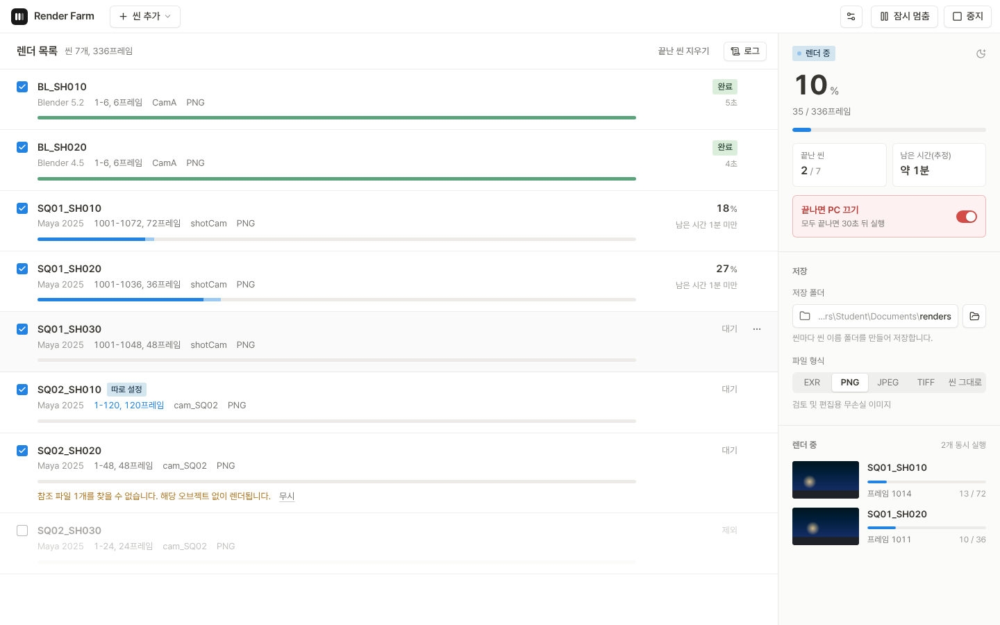
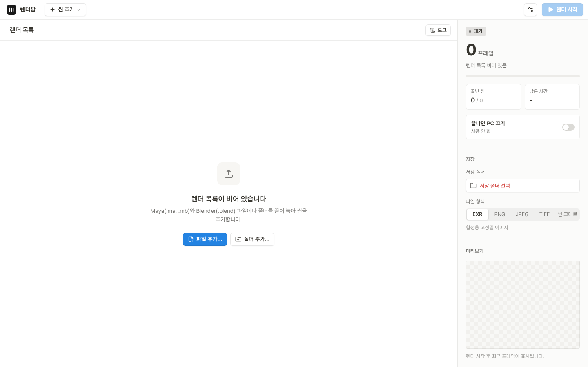
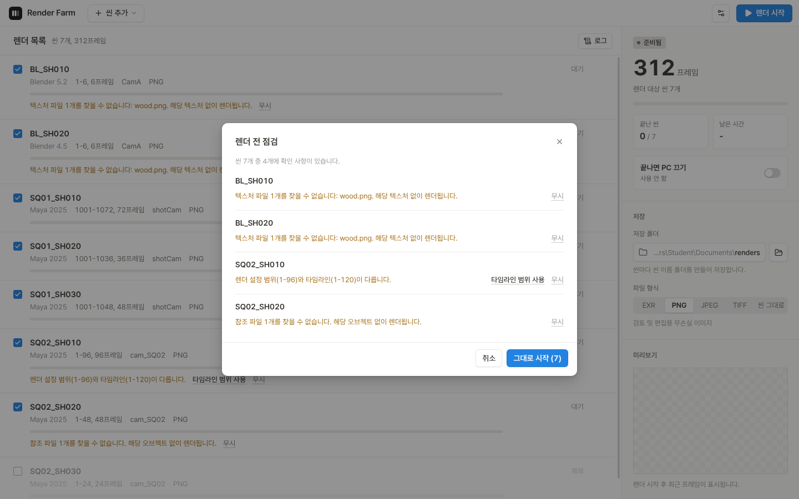
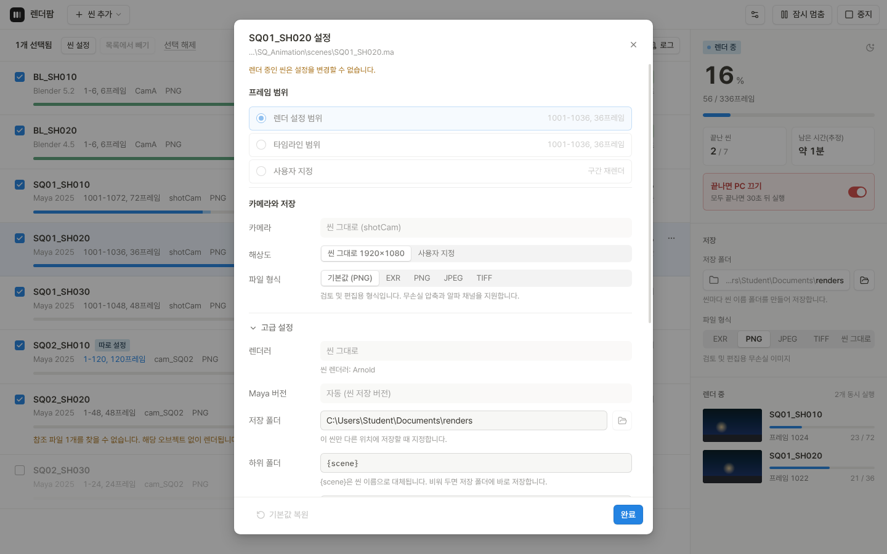
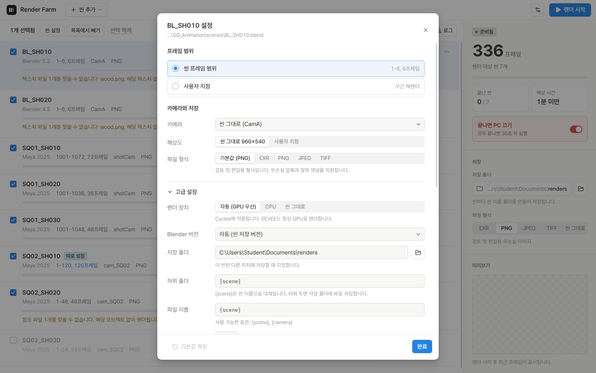
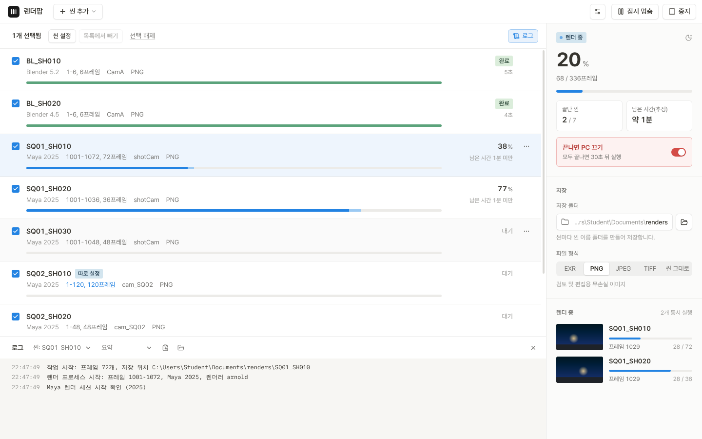
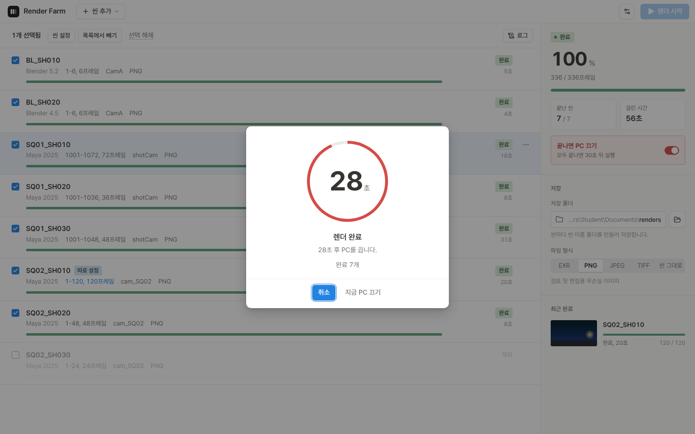
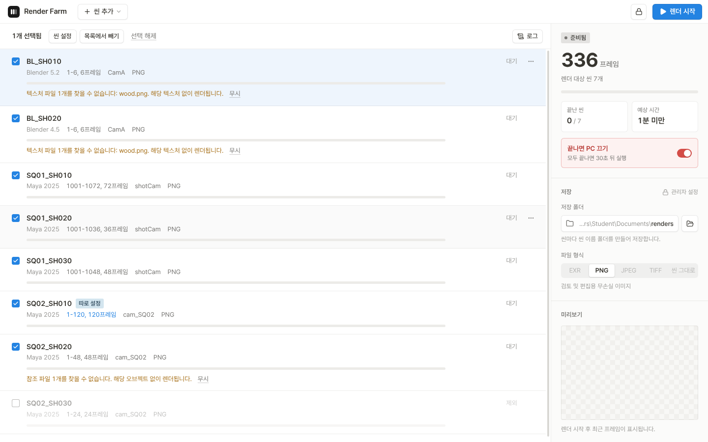
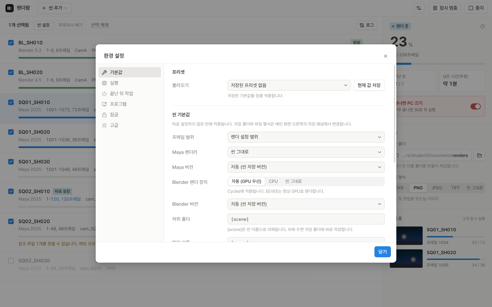
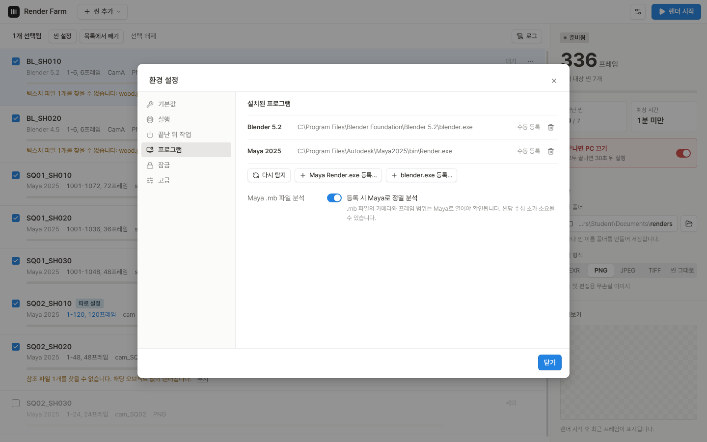

<p align="center">
  
</p>

<h1 align="center">렌더팜</h1>

<p align="center">
  Maya와 Blender 씬을 한 목록에 모아 무인으로 렌더하는 데스크톱 렌더 매니저
</p>

<p align="center">
  <a href="https://github.com/ryonghwon/renderfarm/releases/latest"></a>
  
  
  
</p>

<p align="center">
  <a href="https://github.com/ryonghwon/renderfarm/releases/latest"><b>다운로드</b></a>
  &nbsp;&nbsp;|&nbsp;&nbsp;
  <a href="#시작하기">시작하기</a>
  &nbsp;&nbsp;|&nbsp;&nbsp;
  <a href="#화면">화면</a>
  &nbsp;&nbsp;|&nbsp;&nbsp;
  <a href="#동작-방식">동작 방식</a>
</p>

<br>



## 소개

렌더팜은 여러 개의 씬을 한 번에 걸어 두고 자리를 비워도 끝까지 렌더되도록 만든 실습실용 렌더 매니저입니다. 씬을 끌어 놓으면 프레임 범위, 카메라, 참조 파일을 바로 읽어 렌더 전에 문제를 알려 줍니다. 렌더가 끝나면 빠진 프레임을 찾아 그 프레임만 다시 렌더하고, 모든 씬이 끝나면 PC를 끕니다.

## 주요 기능

- **Maya와 Blender 통합 목록**: .ma, .mb, .blend 씬을 한 목록에서 순서대로 또는 동시에 렌더
- **씬 파일 직접 분석**: 프로그램을 열지 않고 프레임 범위, 해상도, 카메라, 렌더 레이어, 참조 파일, 없는 텍스처 확인
- **렌더 전 점검**: 카메라 누락, 저장 경로 겹침, 범위 불일치를 렌더 시작 전에 표시하고 한 번에 수정
- **프레임 검증**: 렌더 후 프레임 파일을 직접 확인하고 빠진 프레임만 자동으로 다시 렌더
- **이어서 렌더**: 중지하거나 앱을 다시 실행해도 남은 프레임부터 렌더
- **장애 대응**: 프로그램 비정상 종료 시 지연 후 재시도, Arnold 라이선스 반환 대기
- **예상 시간**: 씬 여는 시간과 프레임당 시간을 따로 기록해 남은 시간 계산
- **무인 운영**: 렌더 중 절전 방지, 완료 알림, 모든 씬이 끝나면 카운트다운 후 PC 끄기
- **GPU 자동 선택**: Blender Cycles에서 OptiX, CUDA, HIP, oneAPI, Metal 순으로 GPU 탐색
- **실습실 관리**: PIN 설정 잠금, 기본값 프리셋, 학생이 바꿀 수 있는 항목 제한

## 다운로드

[최신 릴리스](https://github.com/ryonghwon/renderfarm/releases/latest)에서 둘 중 하나를 받습니다.

| 파일 | 용도 |
| --- | --- |
| `RenderFarm-Setup-<버전>.exe` | 설치형, 시작 메뉴와 바탕 화면 바로 가기 생성 |
| `RenderFarm-Portable-<버전>.exe` | 설치 없이 바로 실행, 실습실 공용 PC용 |

> 코드 서명이 없는 앱이라 처음 실행할 때 Windows의 "PC 보호" 창이 표시됩니다. **추가 정보**를 누른 뒤 **실행**을 누르면 됩니다.

## 시작하기



1. 씬 파일(.ma, .mb, .blend)이나 폴더를 창에 끌어 놓습니다.
2. 오른쪽 **저장** 패널에서 저장 폴더와 파일 형식을 확인합니다.
3. **렌더 시작**을 누릅니다. 확인할 사항이 있으면 렌더 전 점검 창이 열립니다.
4. 자리를 비울 때는 **끝나면 PC 끄기**를 켭니다. 카운트다운 중에는 언제든 취소할 수 있습니다.

Maya와 Blender는 기본 설치 경로에서 자동으로 찾습니다. 다른 위치에 설치했다면 **환경 설정 > 프로그램**에서 직접 등록합니다.

| 프로그램 | 자동 탐지 경로 |
| --- | --- |
| Maya | `C:\Program Files\Autodesk\Maya20xx\bin\Render.exe` |
| Blender | `C:\Program Files\Blender Foundation\Blender x.x\blender.exe`, Steam 설치 경로 |

## 화면

### 렌더 전 점검

렌더를 시작하기 전에 씬마다 문제를 확인합니다. 수정할 수 있는 항목은 버튼 한 번으로 바로 고치고, 무시해도 되는 항목은 그대로 시작할 수 있습니다.



### 씬 설정

씬마다 프레임 범위, 카메라, 해상도, 파일 형식, 저장 위치를 따로 지정합니다. 따로 지정한 씬에는 목록에 "따로 설정" 표시가 붙습니다.

<table>
  <tr>
    <td width="50%"></td>
    <td width="50%"></td>
  </tr>
  <tr>
    <td align="center">Maya 씬</td>
    <td align="center">Blender 씬, 렌더 장치 선택</td>
  </tr>
</table>

### 로그

기본 보기는 렌더팜이 정리한 요약입니다. Maya와 Blender가 직접 출력한 메시지는 보기 선택에서 함께 볼 수 있습니다. 재시도로 복구된 오류는 요약에 표시하지 않습니다.



### 끝나면 PC 끄기

모든 씬이 끝나면 카운트다운 후 PC를 끕니다. 실패한 씬이 있으면 PC를 끄지 않고 기다립니다.



### 실습실 관리

PIN으로 설정을 잠그면 학생은 씬 추가, 프레임 범위, 카메라, 렌더 시작과 중지, 끝나면 PC 끄기만 바꿀 수 있습니다. 저장 폴더와 파일 형식은 관리자 설정으로 고정됩니다.

<table>
  <tr>
    <td width="50%"></td>
    <td width="50%"></td>
  </tr>
  <tr>
    <td align="center">잠금 상태</td>
    <td align="center">기본값과 프리셋</td>
  </tr>
  <tr>
    <td width="50%"></td>
    <td width="50%"></td>
  </tr>
  <tr>
    <td align="center">설치된 프로그램</td>
    <td></td>
  </tr>
</table>

## 동작 방식

| 항목 | 내용 |
| --- | --- |
| 렌더 실행 | 작업마다 Maya `Render.exe` 또는 `blender.exe`를 백그라운드 프로세스로 실행 |
| 저장 경로 | `{저장 폴더}\{씬 이름}\{씬 이름}.0001.png` 기본 구조, 하위 폴더와 파일 이름 규칙은 설정에서 변경 |
| 형식 지정 | Maya는 렌더 직전 MEL로 렌더 설정에 적용, Blender는 설정 스크립트로 적용 |
| 프로젝트 | 씬 상위 폴더의 `workspace.mel`을 찾아 Maya 프로젝트로 지정, 텍스처 상대 경로 유지 |
| 진행률 | 프레임 완료 신호, 렌더러 진행률 로그, 저장 폴더 감시를 함께 사용 |
| 검증 | 렌더 후 프레임 파일 존재 확인, Arnold AOV가 있으면 beauty 기준 |
| 재시도 | 빠진 프레임만 다시 렌더, 비정상 종료 시 20초 대기 후 재시도 |
| 라이선스 | Arnold 라이선스 실패 감지 시 다음 렌더 전 반환 대기(60초부터 단계적 증가), 최대 3회 |
| Blender EXR | 멀티레이어 EXR로 저장, 패스는 한 파일 안의 레이어로 기록 |
| 버전 선택 | 씬을 저장한 버전과 같은 프로그램 우선, 없으면 더 높은 버전 사용 |

설정과 렌더 로그는 `%APPDATA%\RenderFarm`에 저장됩니다. 로그는 작업별, 프로세스별로 남습니다.

## 지원 환경

| 항목 | 내용 |
| --- | --- |
| 운영체제 | Windows 10, 11 (x64) |
| Maya | Render.exe가 포함된 Maya, Arnold 렌더 확인. V-Ray, Redshift는 씬에 설정된 파일 형식으로 렌더 |
| Blender | Blender 4.5 이상, 4.5와 5.2 씬으로 확인. Cycles, EEVEE |
| macOS | 소스에서 빌드해 실행 가능(`npm run dist:mac`), 정식 배포 전 |

## 알려진 제한

- 영문 외 문자가 들어간 경로의 Maya 씬은 렌더 전 점검에서 경고만 표시
- 교육용 라이선스 환경의 Arnold 배치 렌더 워터마크 여부는 설치 환경에 따라 다름
- 여러 PC에 작업을 나눠 주는 기능은 다음 버전 범위

## 로드맵

- 여러 PC 렌더 분배: 마스터 PC가 공유 폴더의 작업을 렌더 노드에 나눠 주는 구성
- 실습실 현황 대시보드: PC별 렌더 상태와 진행률 확인
- 서명된 설치 파일과 macOS 정식 배포

## 개발

```bash
npm install
npm run dev        # 개발 실행
npm test           # 렌더 엔진 테스트 (모의 Maya, 모의 Blender)
npm run dist:win   # Windows 설치 파일과 포터블 실행 파일
npm run dist:mac   # macOS 앱 (Apple Silicon, Intel)
```

GitHub에서 `v0.2.1` 같은 태그로 릴리스를 발행하면 GitHub Actions가 테스트를 거쳐 Windows 설치 파일과 포터블 실행 파일을 빌드해 그 릴리스에 첨부합니다. `docs/releases/<태그>.md`가 있으면 릴리스 설명도 그 내용으로 채웁니다.

```
src/main/engine     렌더 엔진 (Electron 비의존)
  engine.ts         렌더 목록, 스케줄러, 재시도, 이어서 렌더, 잠금, 끝난 뒤 작업
  probe.ts          .ma 직접 분석, .mb 헤더 분석, mayapy 정밀 분석
  blend.ts          .blend 직접 분석(압축 파일 포함), 실패 시 Blender로 분석
  installs.ts       Maya, Blender 설치 탐지와 버전 선택
  command.ts        Maya 렌더 명령과 MEL, Blender 명령과 설정 스크립트
  runner.ts         프로세스 실행, 로그 해석, 프로세스 트리 종료
  frames.ts         프레임 파일 탐지와 시퀀스 판별
src/main/index.ts   Electron 창, IPC, 알림, 절전 방지
src/renderer        화면 (React)
test                엔진 테스트, 모의 렌더 프로그램, 화면 캡처 스크립트
```

기술 구성은 Electron, React, TypeScript, electron-vite입니다.
