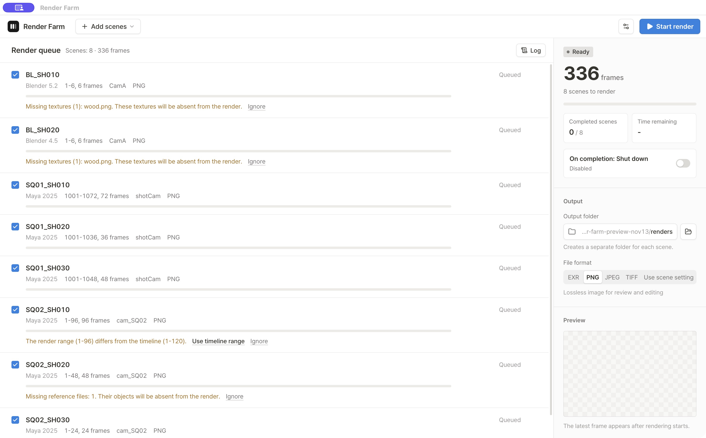
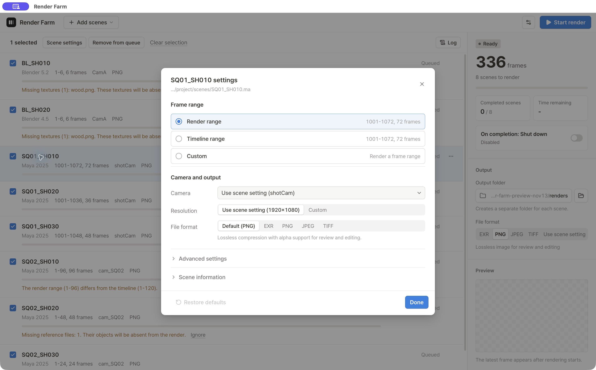
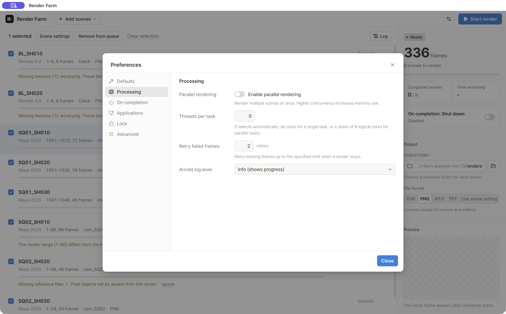

<h1 align="center">Render Farm</h1>

A local render queue for Maya and Blender. Windows and macOS.

<a href="https://github.com/ryonghwon/render-farm/releases">Download</a> · <a href="docs/USAGE.md">User guide</a> · <a href="docs/CONFIGURATION.md">Configuration</a> · <a href="docs/BUILD.md">Build</a>

Render Farm runs Maya and Blender scenes through the applications installed on your computer. Add scenes, choose an output folder, review scene checks, and render the queue. Frame tracking, missing-frame retries, and saved queue state support long sessions and interrupted work.

## Features

- One queue for Maya `.ma` / `.mb` and Blender `.blend` files.
- Sequential or parallel rendering, with per-scene overrides and frame chunks.
- Scene checks for cameras, frame ranges, output collisions, references, and textures.
- Renderer progress, output-file monitoring, and missing-frame retries.
- Restart interrupted jobs from their remaining frames.
- Automatic application discovery and explicit version selection.
- Cycles device selection, including Metal on compatible Macs.
- Output presets, administrator PIN protection, logs, and optional FFmpeg previews.
- Sleep prevention while rendering and optional completion actions.

## Install

Download a package from [Releases](https://github.com/ryonghwon/render-farm/releases).

| System | Package |
| --- | --- |
| Windows x64 | `Render-Farm-<version>-Windows-x64-Setup.exe` or `Portable.exe` |
| Mac with Apple Silicon | `Render-Farm-<version>-macOS-arm64.zip` |
| Mac with Intel processor | `Render-Farm-<version>-macOS-x64.zip` |

Run the Windows installer, or extract the Mac archive and move **Render Farm.app** to Applications. The portable Windows executable uses the same per-user settings directory as the installer.

Maya or Blender must be installed separately, with any required render plugins and licenses. Render Farm runs on the local machine; a shared output folder does not distribute rendering to other computers. Node.js, Docker, and a separate browser are not required for packaged apps.

## Render a queue

1. Drag scene files or folders into the app, or choose **Add scenes**.
2. Set the output folder and format in the **Output** panel.
3. Open **Scene settings** to override a scene's frame range, camera, resolution, or renderer.
4. Select **Start render** and review any preflight checks.
5. Use **Log** and the progress panel to inspect results. Open the output folder to access the rendered files.

**Pause** lets active work finish before scheduling more. **Stop** ends active render processes; starting again resumes unfinished frames. Removing a queue entry does not delete its rendered output.

## Documentation

| Guide | Contents |
| --- | --- |
| [Usage](docs/USAGE.md) | Queue controls, scene overrides, progress, retries, and shortcuts |
| [Configuration](docs/CONFIGURATION.md) | Application paths, output, concurrency, completion actions, and backups |
| [Troubleshooting](docs/TROUBLESHOOTING.md) | Installation discovery, renderer failures, output, and previews |
| [Build](docs/BUILD.md) | Source setup, tests, packaging, and signing |
| [Architecture](docs/ARCHITECTURE.md) | Process boundaries, scheduling, persistence, and renderer integration |

## Screens

| Scene settings | Processing preferences |
| --- | --- |
|  |  |
